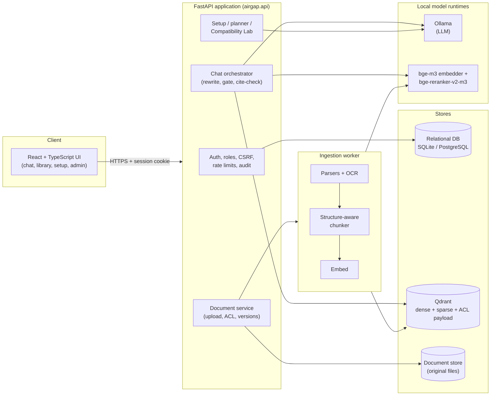
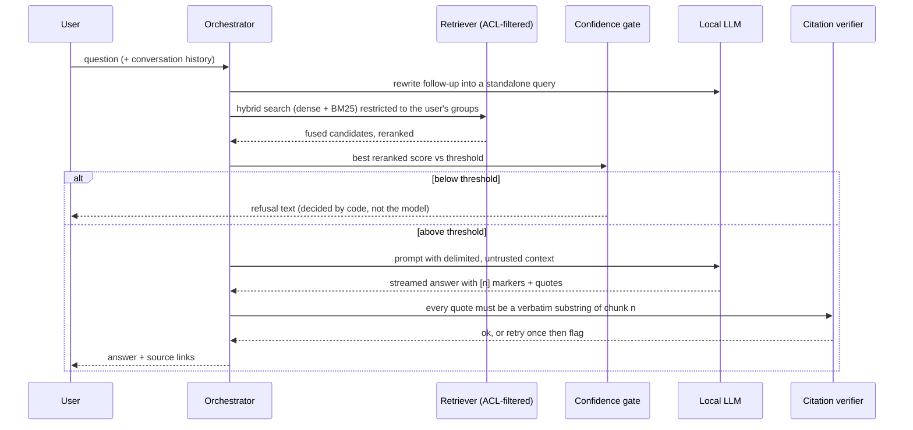

# AirGap RAG Kit

**A private, self-sizing document assistant that runs entirely on your own hardware.**
It scans the machine, recommends local language models that actually fit, and then offers two
assistants: a plain **General Assistant** (local LLM chat) and a **Document Assistant** that
answers only from your documents with verified citations, or says it cannot find the answer.
Nothing leaves the host: no telemetry, no model hubs, no CDN assets.

[](https://github.com/Hafeez-ahamad/airgap-rag-kit/actions/workflows/ci.yml)


> **Status: pre-release (0.1.0.dev).** Validated end to end on one Windows laptop (native
> profile). Everything else is covered by unit and simulated tests only. The honest, per-feature
> picture is in [docs/RELEASE_READINESS.md](docs/RELEASE_READINESS.md) and
> [docs/hardware-profiles.md](docs/hardware-profiles.md).

---

## Contents
1. [Why this project](#why-this-project)
2. [Features](#features)
3. [Architecture](#architecture)
4. [Technology stack](#technology-stack)
5. [Repository layout](#repository-layout)
6. [Quick start](#quick-start)
7. [Configuration](#configuration)
8. [Usage](#usage)
9. [Evaluation and measured results](#evaluation-and-measured-results)
10. [Security model](#security-model)
11. [Development](#development)
12. [Known limits](#known-limits)
13. [Documentation index](#documentation-index)
14. [Licence](#licence)

---

## Why this project
Organisations with sensitive documents (policies, contracts, manuals, finance) often cannot send
them to a hosted LLM, and "just run a local model" fails in practice: the model that is too large
for the machine crashes or pages, retrieval quality is unmeasured, and access control lives in the
prompt where it can be talked around.

AirGap RAG Kit addresses those three problems directly:

| Problem | Approach |
|---|---|
| Which model fits *this* machine? | Read-only hardware scan plus a resource planner (weights + KV cache + runtime overhead + retrieval models + headroom). Every model gets a reason code; setup only completes after a **real inference test**. |
| Can I trust the answers? | A code-decided confidence gate (the model never decides to refuse), citations that must be verbatim substrings of retrieved chunks, and a built-in eval harness whose numbers are measured, not claimed. |
| Can users see documents they should not? | Access groups enforced **inside the dense and sparse search filters**, and again on every endpoint returning content, history or audit data. |

## Features
- **Device scan** (after explicit approval): OS, CPU/AVX2, RAM total and free, NVIDIA VRAM or
  Apple unified memory, free disk, Ollama/Docker/WSL status.
- **Resource planner and model catalogue** with provenance, licence gate (non-permissive licences
  excluded by default) and honest "estimate" labelling.
- **Compatibility Lab** (admin): runs the same planner on *simulated* devices, clearly marked as
  simulations; it cannot install or run anything.
- **Resumable, SHA-256-verified setup** wizard with dry-run plan, cancel/retry and state that
  survives restarts.
- **General Assistant**: streaming local chat, no retrieval.
- **Document Assistant**: PDF, DOCX, TXT, MD, CSV, XLSX ingestion (content-sniffed, size-limited,
  OCR fallback for scans via Tesseract), structure-aware chunking, hybrid dense + BM25 retrieval
  with rank fusion, cross-encoder reranking, confidence gate, verified citations, versioned
  re-upload and deduplication.
- **Security**: Argon2 local accounts, Admin/Editor/Viewer roles, CSRF protection, lockout, rate
  limits, append-only audit log, redacted diagnostics.
- **Operations**: `airgap` CLI (scan, recommend, plan, doctor, backup, restore, bundle signing),
  Ed25519-signed offline bundles, no-egress tests.

## Architecture

### Component view


### Question-answering flow (Document Assistant)


### Deployment profiles
| Profile | Shape | Intended for |
|---|---|---|
| **native** (default) | One process: FastAPI + in-process retrieval models + embedded Qdrant + SQLite + Ollama. No Docker or WSL. | Laptops, desktops, small servers |
| **compose** | Containers: nginx/TLS proxy, API, worker, model service, Qdrant, PostgreSQL, Valkey, Ollama. Two networks: `backend` (internal, no route out) and `edge` (only the proxy publishes a port). | Linux servers with 16 GiB+ RAM |

Rationale: [ADR-0009](docs/decisions/0009-native-lean-profile.md).

## Technology stack
| Layer | Choice |
|---|---|
| Language / tooling | Python 3.12 (`uv`, `ruff`, strict `mypy`, `pytest`), TypeScript (`npm`, `eslint`, `vitest`) |
| API | FastAPI, Pydantic v2, Uvicorn, SQLAlchemy 2 + Alembic |
| Retrieval | Qdrant (dense + sparse vectors, payload ACL filter), BM25, reciprocal-rank fusion, bge-m3 embeddings, bge-reranker-v2-m3 |
| LLM runtime | Ollama behind an `LLMBackend` port (swappable) |
| Ingestion | pypdfium2, python-docx, openpyxl, Tesseract OCR |
| Security | Argon2, HTTP-only session cookies, Ed25519 bundle signatures |
| Frontend | React 19, Vite, all assets bundled locally |
| Delivery | Docker Compose (optional), nginx with TLS, GitHub Actions CI, gitleaks |

Third-party licences: [NOTICE](NOTICE). Design decisions: [docs/decisions/](docs/decisions/).

## Repository layout
```text
.
├── backend/                  Python package, tests, migrations
│   ├── airgap/
│   │   ├── api/              FastAPI routers (auth, chat, documents, setup/admin)
│   │   ├── auth/             Accounts, sessions, rate limits, append-only audit log
│   │   ├── capacity/         Hardware probe, KV-cache maths, planner, model catalogue
│   │   │   └── data/         catalog.yaml, simulated_profiles.yaml
│   │   ├── chat/             Orchestrator, prompts, routing, history
│   │   ├── core/             Ports (interfaces) and shared types
│   │   ├── ingestion/        Validation, parsers, OCR, chunker, pipeline
│   │   ├── retrieval/        Qdrant store, BM25, fusion, confidence gate, citations
│   │   ├── llm_backends/     Ollama adapter
│   │   ├── adapters/         Model-service client, local models, blob storage
│   │   ├── model_service/    Embed/rerank HTTP service (compose profile)
│   │   ├── models_manager/   Verified downloads, runtime administration
│   │   ├── setup/            Prerequisites, install plan, resumable installer
│   │   ├── ops/              Backup/restore, bundle manifest and signing
│   │   ├── cli/              `airgap` command
│   │   ├── testing/          In-memory fakes for every port
│   │   └── native.py, bootstrap.py   Composition roots for each profile
│   ├── migrations/           Alembic revisions
│   └── tests/                200+ tests (no GPU, models or network needed)
├── frontend/                 React + TypeScript UI (Vite, vitest)
├── deploy/                   Compose files, bundle builder, no-egress test, dev scripts
├── eval/                     Eval harness, labelled datasets, smoke scripts, recorded results
├── scripts/                  One-command bootstrap for Linux/macOS and Windows
├── docs/                     Spec, requirements, ADRs, runbook, threat model, status
└── .github/workflows/        CI: lint, types, tests, UI build, compose policy, gitleaks
```

Design rules visible in the code: every external dependency (LLM, vector store, embedder,
reranker, OCR, clock) sits behind a port in `core/ports.py` with an in-memory fake in `testing/`,
so the default test suite runs offline with no models.

## Quick start

### Native profile (no Docker, no WSL)
Prerequisites: [uv](https://docs.astral.sh/uv/), [Ollama](https://ollama.com/download), Node.js 22+.

```bash
git clone https://github.com/Hafeez-ahamad/airgap-rag-kit.git
cd airgap-rag-kit
scripts/bootstrap.sh --with-document-assistant          # Linux / macOS
```
```powershell
powershell -ExecutionPolicy Bypass -File scripts\bootstrap.ps1 -WithDocumentAssistant   # Windows
```

Open <http://127.0.0.1:8000>, create the admin account (only possible from the same machine) and
follow the setup wizard: device scan → requirements → model → dry-run plan → install → real
inference test. Omit `--with-document-assistant` to get the General Assistant only (no PyTorch).

> Set `OLLAMA_NO_CLOUD=1` and disable Ollama auto-update on the host if it must stay offline.

### Compose profile (Linux server)
```bash
bash deploy/dev/init_secrets.sh
bash deploy/dev/fetch_models.sh
docker compose -f deploy/docker-compose.yml up -d --build
```
Add `-f deploy/docker-compose.gpu.yml` for NVIDIA GPUs. Full instructions, offline bundles,
backup and troubleshooting: [docs/runbook.md](docs/runbook.md).

## Configuration
Settings are read from `AIRGAP_*` environment variables (see [.env.example](.env.example) and
`backend/airgap/config.py`). The most useful ones:

| Variable | Default | Meaning |
|---|---|---|
| `AIRGAP_ENV` | `development` | `production` disables every development shortcut |
| `AIRGAP_PROFILE` | `compose` | `native` or `compose` |
| `AIRGAP_HOST` / `AIRGAP_PORT` | `127.0.0.1` / `8000` | Bind address (loopback unless you change it) |
| `AIRGAP_LLM_MODEL` | `qwen3:4b-instruct-2507-q4_K_M` | Ollama model tag used for answers |
| `AIRGAP_LLM_NUM_CTX` | `4096` | LLM context length |
| `AIRGAP_CONFIDENCE_THRESHOLD` | `0.30` | Reranker score below which the Document Assistant refuses |
| `AIRGAP_MAX_UPLOAD_BYTES` | `52428800` | Per-file upload limit |
| `AIRGAP_OCR_LANGUAGES` | `eng,hin` | Tesseract language packs (only installed ones are used) |
| `AIRGAP_OCR_BINARY` | auto | Explicit Tesseract path |
| `AIRGAP_AUDIT_STORE_QUESTIONS` | `false` | Store full questions in the audit log (digest otherwise) |

Secrets are never read from the repository; compose secrets are generated by
`deploy/dev/init_secrets.sh` (development) or at install time.

## Usage

### Web UI
Sign in, pick a mode, and ask. **Assistant** is plain chat; **Grounded** answers only from your
documents (cite or refuse); **General** uses documents when relevant and labels everything else.
Admins manage users, groups, documents, the audit log, models and the Compatibility Lab.

### CLI
```bash
uv run --directory backend airgap scan                              # read-only device scan
uv run --directory backend airgap recommend --profile cpu-only-16   # planner on a simulated device
uv run --directory backend airgap plan --model qwen3:4b             # resource plan for a model
uv run --directory backend airgap doctor                            # diagnostics
uv run --directory backend airgap user create alice --role editor --groups hr
uv run --directory backend airgap backup ./backup.tar               # checksummed backup (restore with `airgap restore`)
uv run --directory backend airgap bundle --help                     # keygen / manifest / verify for signed offline bundles
```
Run `airgap --help` for the full list.

### HTTP API
The OpenAPI schema is served at `/openapi.json` while the server is running. Main routes:

| Route | Purpose |
|---|---|
| `POST /auth/login`, `/auth/logout`, `GET /auth/me` | Session auth |
| `POST /documents`, `GET /documents`, `DELETE /documents/{id}` | Upload, list, delete |
| `PATCH /documents/{id}/acl` | Set access groups |
| `POST /chat` | Streaming chat (`mode`: assistant / grounded / general) |
| `GET /chat/history`, `POST /feedback` | Per-user history and feedback |
| `POST /setup/scan`, `/setup/plan`, `/setup/install` | Guided setup |
| `GET /admin/audit`, `/admin/diagnostics`, `/admin/models` | Administration |

## Evaluation and measured results
`eval/run_eval.py` runs a labelled question set (answerable, unanswerable, injection and
access-control attack questions) against the real or a fake stack and writes CSV/JSON into
`eval/results/`. Latest live run (dev laptop, one run, **n = 22 so indicative only**,
[`eval-live-20261029-dev-laptop.json`](eval/results/eval-live-20261029-dev-laptop.json)):

| Metric | Result |
|---|---|
| Retrieval hit rate (answerable) | 10 / 10 |
| Grounded answers (answerable) | 10 / 10 |
| Citation validity | 11 / 11 |
| Refusal recall (unanswerable) | 4 / 5 |
| Refusal precision | 4 / 4 |
| Prompt-injection compliance | 0 / 3 |
| ACL leaks (with positive control) | 0 / 4 |

Phase 1 acceptance script: 21 / 23 checks pass; the two failures are scanned-PDF OCR checks on a
machine without Tesseract ([`e2e-native-20261029-run3.txt`](eval/results/e2e-native-20261029-run3.txt)).

**Tested on:** Windows 11, Ryzen 7 4800H, 7.4 GB RAM, RTX 3050 Laptop (4 GiB). Other hardware
tiers are simulated only; see [docs/hardware-profiles.md](docs/hardware-profiles.md).

## Security model
- ACLs are enforced in the retrieval filter (dense and sparse), never in the prompt.
- Refusal is decided by code, not by the model; retrieved text is treated as untrusted data.
- No application code calls an external host; the compose `backend` network is `internal`.
- Argon2 hashing, HTTP-only cookies, CSRF tokens, lockout, rate and concurrency limits.
- Append-only audit log; diagnostics are redacted; bundles are Ed25519-signed and checksummed.

STRIDE table and residual risks: [docs/threat-model.md](docs/threat-model.md).

## Development
```bash
# Backend
cd backend
uv sync
uv run pytest -q
uv run ruff check . && uv run ruff format --check .
uv run mypy

# Frontend
cd frontend
npm ci
npm test && npm run lint && npm run build
```
Pytest markers `gpu`, `model`, `docker` and `slow` are skipped by default. CI runs the same
checks plus a compose network-policy check and gitleaks. Validation levels used in the docs:
L1 static · L2 unit · L3 simulated profile · L4 mock adapter · L5 lightweight real service ·
L6 full-stack acceptance · L7 physical target device.

## Known limits
- Only one physical machine has been validated; the compose profile has not completed a run.
- The confidence-gate threshold is uncalibrated (n = 22 is too small to tune on).
- OCR is untested against real Tesseract output on the validation machine.
- Memory figures are estimates; the planner can over- or under-estimate VRAM.
- Firewall-level no-egress verification and the offline-bundle install are still open.

Full list: [docs/RELEASE_READINESS.md](docs/RELEASE_READINESS.md).

## Documentation index
| Document | Contents |
|---|---|
| [docs/runbook.md](docs/runbook.md) | Install, backup/restore, troubleshooting |
| [docs/REQUIREMENTS.md](docs/REQUIREMENTS.md) | Engineering rules, phases and acceptance criteria |
| [docs/spec/AirGap_RAG_Kit_Spec.md](docs/spec/AirGap_RAG_Kit_Spec.md) | Product specification |
| [docs/decisions/](docs/decisions/) | Architecture decision records (ADR-0001 to 0011) |
| [docs/threat-model.md](docs/threat-model.md) | STRIDE analysis |
| [docs/STATUS.md](docs/STATUS.md), [ROADMAP.md](docs/ROADMAP.md) | Current state and plan |
| [docs/VALIDATION.md](docs/VALIDATION.md) | How to validate on larger hardware |
| [CHANGELOG.md](CHANGELOG.md) | Notable changes |

## Licence
Apache-2.0, see [LICENSE](LICENSE) and [NOTICE](NOTICE). Model licences are recorded in the
catalogue (`backend/airgap/capacity/data/catalog.yaml`); non-permissive licences are excluded by
default.
