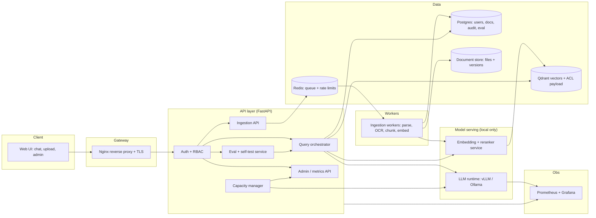

# AirGap RAG Kit — Self-Sizing, Air-Gapped Document Assistant

*Working title. Status: **specification — nothing here is built yet.** Every "will" below is a plan; model names are candidates to be benchmarked and licence-checked, not claims.*

**One line:** Install it on any server, drop in your documents, and it detects the hardware, picks a model that fits, runs fully offline, answers with citations, and reports its own measured accuracy.

---

## Table of contents
1. [Problem and target users](#1-problem-and-target-users)
2. [Goals and non-goals](#2-goals-and-non-goals)
3. [Feature list](#3-feature-list)
4. [Auto hardware adaptation (the headline feature)](#4-auto-hardware-adaptation-the-headline-feature)
5. [Architecture](#5-architecture)
6. [Tech stack](#6-tech-stack)
7. [Query and ingestion flows](#7-query-and-ingestion-flows)
8. [Security model](#8-security-model)
9. [Evaluation and benchmarking plan](#9-evaluation-and-benchmarking-plan)
10. [Offline packaging and installation](#10-offline-packaging-and-installation)
11. [API surface](#11-api-surface)
12. [Repository layout](#12-repository-layout)
13. [Build phases, effort and acceptance criteria](#13-build-phases-effort-and-acceptance-criteria)
14. [Risks and honest limits](#14-risks-and-honest-limits)
15. [What the recruiter sees](#15-what-the-recruiter-sees)
16. [How this differs from Ollama, LM Studio and chat-UI tools](#16-how-this-differs-from-ollama-lm-studio-and-chat-ui-tools)

---

## 1. Problem and target users

**Problem.** Organisations with sensitive documents (banks, hospitals, manufacturers, government-adjacent teams) want an AI assistant over internal files but cannot send data to hosted APIs. Today they face three obstacles:
1. **Setup complexity:** choosing a model, runtime, quantisation and context size that fit their particular server is expert work.
2. **Trust:** nobody can tell how accurate the answers are on *their* documents.
3. **Operations:** no access control, audit trail, backup or upgrade path in typical open-source demos.

**Users.** (a) IT admin installing it on an on-prem server; (b) employees asking questions; (c) a security/compliance reviewer who needs the audit trail and the proof that nothing leaves the network.

---

## 2. Goals and non-goals

**Goals**
- Works with **no internet**, including at install time (offline bundle).
- **One-command install** that adapts to the hardware it finds.
- **Citations or refusal**: grounded answers point to source passages; unsupported questions are declined.
- **Measured quality:** built-in self-test and a published benchmark.
- **Enterprise basics:** login, roles, per-document access control, audit log.

**Non-goals (v1)**
- Training or fine-tuning models.
- Multi-node clustering.
- Agentic web browsing or any outbound call.
- Guaranteeing "perfect" answers. The promise is *grounded, cited, measured*.
- Code execution sandbox (coding mode is v2 and generates text only).

---

## 3. Feature list

### 3.1 Core user features
| # | Feature | Detail |
|---|---|---|
| F1 | **Drag-and-drop upload** | PDF, DOCX, TXT, MD, CSV, XLSX; folder upload; progress and per-file status (queued / parsing / embedding / ready / failed) |
| F2 | **OCR for scans** | Offline Tesseract (English plus Indic language packs); automatic detection of image-only PDFs |
| F3 | **Duplicate and version handling** | Content-hash dedupe; re-upload of a changed file replaces the old version and re-indexes only that file |
| F4 | **Three answer modes** | **Grounded-only** (documents only, cite or refuse) · **General assistant** (free answers; uses documents when relevant; uncited content labelled "general knowledge") · **Coding assistant** *(v2, text only)* |
| F5 | **Citations** | Every grounded answer lists document, page/section and the quoted passage; click to open the source |
| F6 | **Safe refusal** | If retrieval confidence is below a configured threshold: "I could not find this in your documents" instead of guessing |
| F7 | **Conversation memory** | Follow-up questions rewritten into standalone queries; per-user history |
| F8 | **Multilingual retrieval** | Multilingual embedding model so Hindi/other Indian-language documents and queries work |
| F9 | **Feedback** | Thumbs up/down plus "wrong answer" report feeding the evaluation set |

### 3.2 Admin and operations features
| # | Feature | Detail |
|---|---|---|
| F10 | **Hardware profile report** | Shows detected hardware, chosen tier, model, settings, and expected capacity |
| F11 | **Self-test ("Trust report")** | After upload, generates test questions from the documents (plus any the admin pastes), runs them, reports hit@k, grounded-answer rate, refusal accuracy |
| F12 | **Admin dashboard** | GPU/VRAM and RAM use, tokens/s, time-to-first-token, p50/p95 latency, queue depth, active users, error rate |
| F13 | **Roles and document ACLs** | Admin / Editor / Viewer; each document assigned to groups; ACL enforced at **retrieval time** |
| F14 | **Audit log** | Who asked what, which documents were retrieved, which model answered, refusal or answer; exportable |
| F15 | **Rate limits and quotas** | Per-user concurrency and request caps to protect the GPU |
| F16 | **Backup / restore / upgrade-with-rollback** | One command each; versioned config and indexes |
| F17 | **Offline update path** | New models and releases arrive as signed bundles on removable media |
| F18 | **Health checks and self-healing** | Container health probes; automatic restart; degraded-mode banner if the model fails |

### 3.3 Safety features
| # | Feature | Detail |
|---|---|---|
| F19 | **Prompt-injection hardening** | Retrieved text is delimited as data; instructions inside documents are ignored; red-team test set |
| F20 | **Optional PII redaction** | Pattern/NER-based masking before indexing or in logs (configurable) |
| F21 | **No-egress proof** | Compose network marked internal; automated test that fails if any outbound connection succeeds |

### 3.4 Multi-model management (new)
| # | Feature | Detail |
|---|---|---|
| F22 | **Model library and install-from-bundle** | Admin sees every model in the catalog with size, licence, and a live "fits on this hardware / fits alongside current models / does not fit" indicator. "Install" means importing from the offline bundle or a local path, with SHA-256 verification (an air-gapped server cannot pull from the internet) |
| F23 | **VRAM planner (packing)** | Before install, checks `Σ(weights) + Σ(minimum KV cache for target context) + runtime overhead ≤ usable VRAM`. Shows the remaining budget and the resulting concurrency for each model combination |
| F24 | **Co-resident models** | Keeps several models loaded at once when they fit (for example a ~20B reasoning model plus a ~3B fast model on a 32 GB GPU) |
| F25 | **Request routing** | Per-request model selection: (a) user picks the model, (b) mode-based defaults (grounded-answer → large model), (c) role-based pipeline routing: small model for query rewriting, intent classification, titles and summaries; large model for final answers, (d) rule-based fallbacks |
| F26 | **Load/evict policy** | Models can be *pinned* (always resident) or *on-demand* (loaded when requested, evicted least-recently-used after an idle time). Warm-up on start; cold-start latency is shown in the UI |
| F27 | **Per-model limits and health** | Per-model concurrency, queue, and context caps; per-model tokens/s and latency; automatic fall-back to another model if one fails |
| F28 | **Model-aware evaluation** | The trust report can be re-run per model and per routing policy, so an admin can see whether the small model is good enough for a given task |

---

## 4. Auto hardware adaptation (the headline feature)

The installer and a runtime "capacity manager" turn raw hardware into a safe, tested configuration instead of asking the admin to guess.

### 4.1 Probe
| Resource | How detected |
|---|---|
| NVIDIA GPUs, VRAM, driver, compute capability | NVML (`pynvml`) / `nvidia-smi` |
| System RAM, swap | `/proc/meminfo` (psutil) |
| CPU model, cores, AVX2/AVX-512 | `lscpu` / `/proc/cpuinfo` |
| Free disk and disk type | `df`, `lsblk` |
| Apple Silicon unified memory (optional) | `sysctl` |
| AMD ROCm (stretch goal) | `rocm-smi` |

### 4.2 Decision pipeline
```
probe hardware
   → classify into a tier (no-GPU / small / medium / large / multi-GPU)
   → filter the model catalog by: fits in memory, licence allows use, has offline weights in bundle
   → choose runtime (llama.cpp/Ollama on small or CPU; vLLM on NVIDIA GPU for concurrency)
   → choose quantisation and context length
   → compute the concurrency limit from the KV-cache budget
   → run a 60-second micro-benchmark (tokens/s, time-to-first-token, no OOM)
   → if below minimum thresholds, step down one model/quantisation and repeat
   → write the resolved profile to profile.yaml and show it in the admin UI
```

### 4.3 Capacity maths (concurrency)
KV-cache memory per token ≈ `2 × layers × kv_heads × head_dim × bytes_per_element`.
`KV budget = usable VRAM − model weights − runtime overhead`.
`max concurrent sessions ≈ KV budget ÷ (context length × KV bytes per token)`.
The kit computes this for the chosen model and context, applies a safety margin, then sets the runtime limits (for example vLLM `--gpu-memory-utilization`, `--max-model-len`, `--max-num-seqs`; Ollama `OLLAMA_NUM_PARALLEL` and `num_ctx`). The **benchmark phase verifies the prediction** against measured behaviour; the gap is reported.

### 4.4 Illustrative tier table (to be replaced by measured values)
| Tier | Typical hardware | Runtime | Model size class | Notes |
|---|---|---|---|---|
| T0 | CPU only | llama.cpp / Ollama | ~3–8B, 4-bit | Low concurrency; slower; UI warns |
| T1 | 8–12 GB VRAM | Ollama | ~7–9B, 4-bit | Light use |
| T2 | 16–24 GB VRAM | Ollama or vLLM | ~8–14B, or ~20B 4-bit | Small teams |
| T3 | 32–48 GB VRAM | vLLM | ~20–35B class | Your reference tier |
| T4 | Multi-GPU / 80 GB+ | vLLM, tensor parallel | larger | Stretch goal |

The tier boundaries and exact models are decided **only after** benchmarking on machines you actually have. Claim only tested tiers.

### 4.5 Model catalog (`catalog.yaml`)
Each entry: model id, runtime, quantisation, weight file path and SHA-256, parameter count, layers/kv-heads/head-dim (for the KV maths), max context, minimum memory, languages, **licence and commercial-use flag**, and the measured benchmark results. Candidate families to evaluate (verify licence and availability before use): Qwen, Llama, Gemma, Mistral, gpt-oss-20b. Embeddings: a multilingual model such as bge-m3; reranker: a BGE reranker.

### 4.6 Runtime adaptation (not just at install)
- **Load shedding:** when VRAM or queue depth is high, new requests queue or receive a "busy, try again" response instead of crashing the server.
- **Dynamic context cap:** very long prompts are truncated or summarised according to the current free KV budget.
- **Mode vs memory:** if two models (general + coding) don't fit together, load one and swap on demand; the admin UI shows swap latency.
- **Re-profile command:** `airgap profile --rerun` after a GPU/RAM change.

### 4.7 Multi-model manager (co-residency, installation and routing)

**Does the idea make sense? Yes, with constraints the design must respect.**

*Why it works:* a 4-bit-class ~20B model and a ~3B model can share a 32 GB GPU. For example, gpt-oss-20b is documented as designed to run within 16 GB, using MXFP4 weights of roughly 12–13 GB ([IntuitionLabs summary](https://intuitionlabs.ai/articles/hardware-requirements-gpt-oss-20b)); a small 3B model in 4-bit is a few GB. That leaves memory for caches. Treat these as starting estimates and measure on your own machine.

*What the design must respect:*
1. **Every resident model consumes KV-cache memory of its own.** Co-residency lowers the concurrency each model can serve. The planner must show that trade-off, not just "it fits".
2. **Runtimes differ.** Ollama can keep several models loaded and unload idle ones (controlled by settings such as `OLLAMA_MAX_LOADED_MODELS`, `OLLAMA_NUM_PARALLEL` and keep-alive; confirm the exact current behaviour in its docs before relying on it). vLLM serves one model per server process, so co-residency means several vLLM processes with `--gpu-memory-utilization` fractions that sum below 1. Both need the capacity manager to allocate memory explicitly.
3. **Cold starts cost seconds to tens of seconds** when loading a large model from disk. Pin the models you need for every request; evict only the optional ones.
4. **Two processes share one GPU's compute.** Latency of the large model rises while the small model is busy; benchmark mixed load, not each model alone.
5. **Routing quality is a risk.** Start rule-based (explicit selection and fixed pipeline roles). Do not use an LLM router in v1; add learned or automatic task routing only after the evaluation shows it helps.

**Planner algorithm (install time and when the admin changes selection):**
```
for each candidate combination the admin selects:
    weights   = Σ model file sizes (after quantisation)
    kv_min    = Σ KV bytes/token × target_context × min_sessions_per_model
    overhead  = runtime + CUDA context + safety margin (e.g. 10%)
    if weights + kv_min + overhead ≤ usable VRAM:  feasible
        remaining_kv = usable VRAM − weights − overhead
        concurrency  = allocate remaining_kv across models by policy
    else:  show "does not fit" + suggestions (smaller quantisation, shorter context, drop a model)
run the micro-benchmark with the chosen combination; step down if it fails
```

**Routing policy examples (config, not code):**
```yaml
routes:
  grounded_answer:   { model: large,  fallback: large-cpu-offload }
  general_chat:      { model: large }
  query_rewrite:     { model: small }
  intent_classify:   { model: small }
  title_summary:     { model: small }
pinned: [large, small]
on_demand: [coding]   # loaded when first requested, evicted after 10 min idle
```

**Measure it:** report latency and answer quality with (a) one model for everything vs (b) small model for helper steps. If (b) is not faster or equal in quality, say so in `BENCHMARK.md`.

---

## 5. Architecture



### Components
| Component | Responsibility |
|---|---|
| **Web UI** | Chat with mode selector, citation viewer, upload page, admin dashboard, trust report |
| **Reverse proxy** | TLS, request size limits, static assets |
| **Auth + RBAC** | Local accounts (optionally LDAP/OIDC on the internal network), sessions/JWT, role and group checks |
| **Query orchestrator** | Query rewrite → hybrid retrieval with ACL filter → rerank → confidence gate → prompt assembly → generation → citation verification |
| **Ingestion workers** | Parse, OCR, structure-aware chunking, embed, index, update status |
| **Capacity manager** | Hardware probe, tier decision, KV maths, micro-benchmark, runtime configuration, load shedding |
| **Model manager / router** | Model library, VRAM planner, install-from-bundle, load/evict policy, per-request and per-pipeline-step model routing, per-model health and fall-back |
| **Eval service** | Question generation, scoring, trust report, regression runs |
| **LLM runtime** | Serves the chosen model with settings from `profile.yaml` |
| **Embedding / reranker service** | Local embeddings and cross-encoder reranking |
| **Datastores** | Qdrant (vectors + ACL metadata), Postgres (relational + audit), file store, Redis |
| **Observability** | Prometheus metrics, Grafana dashboards, structured JSON logs |

### Design decisions
- **ACL in the retrieval filter**, not the prompt: users can never retrieve chunks they cannot read.
- **Citation verification:** after generation, check that quoted spans exist in the retrieved chunks; flag or retry otherwise.
- **Deterministic gates around the LLM:** retrieval-score threshold and refusal decided by code, not by the model.
- **Runtime abstraction:** one `LLMBackend` interface with Ollama and vLLM adapters so profiles can switch runtimes.

---

## 6. Tech stack

| Layer | Choice | Why |
|---|---|---|
| Language | Python 3.12, TypeScript | Python for the backend and ML glue, TypeScript for the UI |
| API | FastAPI, Pydantic, Uvicorn | Typed contracts, async |
| LLM serving | **vLLM** (NVIDIA GPU, concurrency), **Ollama / llama.cpp** (CPU and small GPU) | Right runtime per hardware tier |
| Embeddings / reranking | Sentence-Transformers models (multilingual embedding + BGE reranker) | Runs fully local |
| Vector store | **Qdrant** (payload filtering for ACLs, hybrid support) | Self-hosted; filter-friendly |
| Keyword search | BM25 (Qdrant sparse vectors, or `rank_bm25`) | Hybrid retrieval |
| Relational DB | PostgreSQL (SQLite for dev) | Users, docs, audit, evaluation |
| Queue / cache | Redis | Ingestion queue, rate limits |
| Parsing / OCR | PyMuPDF, python-docx, openpyxl, Tesseract OCR | Offline document handling |
| Chunking | Structure-aware splitter (headings, tables) with overlap | Better retrieval than flat splitting |
| Frontend | React + TypeScript + Vite | Chat, upload, dashboards |
| Auth | Argon2 password hashing, JWT/session cookies, optional LDAP/OIDC | Enterprise-friendly |
| Observability | Prometheus, Grafana, `pynvml` exporter, structured logging | Capacity and performance visibility |
| Packaging | Docker, Docker Compose (internal network), offline image tarballs, install script | Reproducible air-gapped install |
| Testing | pytest, Playwright (UI smoke), Locust or k6 (load), `gitleaks` (secrets) | Evidence of quality |
| CI | GitHub Actions (tests, lint, container build, no-egress test) | Visible discipline |
| Evaluation | Custom harness: hit@k, MRR, grounded rate, refusal P/R, judge-vs-human agreement | Measured trust |

---

## 7. Query and ingestion flows

### Ingestion
1. User uploads files → size/type checks → hash → dedupe/version.
2. Job queued (Redis) → worker parses; image-only pages go to OCR.
3. Structure-aware chunking; attach metadata (doc id, version, page, section, ACL groups, language).
4. Embed → upsert to Qdrant; update Postgres status.
5. Optional auto-generated eval questions stored for the trust report.

### Query (grounded mode)
1. Authenticate; load user groups; apply rate limit.
2. Rewrite follow-up into a standalone query.
3. Hybrid retrieval (dense + BM25) **with ACL filter** → rerank top candidates.
4. **Confidence gate:** if best score is below threshold → refusal with "not found".
5. Build prompt with delimited context; generate with the profile's model.
6. Verify citations; log audit entry; stream the answer with source links.

### General mode
Same pipeline, but the confidence gate does not refuse. Answers that use no retrieved evidence carry a "general knowledge, not from your documents" label.

---

## 8. Security model

| Area | Control |
|---|---|
| Network | Internal-only Docker network; no default route out; automated **no-egress test** in CI and in the trust report |
| Authentication | Local accounts with Argon2; lockout/rate limit on login; optional LDAP/OIDC |
| Authorisation | Roles (Admin/Editor/Viewer) + document groups; ACL applied in the vector query |
| Data at rest | Optional disk encryption guidance; secrets from environment/secret files, never in repo |
| Uploads | Type and size limits, filename sanitisation, parsing in a low-privilege worker, no execution |
| Prompt injection | Context delimiting, instruction hierarchy, injection test set (documents containing hostile instructions) |
| Audit | Immutable-style audit table (append-only permissions), export, retention setting |
| Privacy | Optional PII redaction; logs avoid storing full document text by default |
| Supply chain | Pinned dependencies/lockfile, image digest pinning, SHA-256 verified model bundle |
| Threat model | One-page STRIDE-style table in `docs/threat-model.md` |

---

## 9. Evaluation and benchmarking plan

### 9.1 Quality evaluation (all numbers measured, none assumed)
| Metric | Method |
|---|---|
| Retrieval hit@k, MRR | 60–100 labelled questions on a public + synthetic corpus |
| Grounded-answer rate | Human-labelled sample (2 raters on a subset); judge model used only after calibration |
| Refusal precision/recall | Unanswerable questions included on purpose |
| Citation correctness | Programmatic: quoted span exists in the cited chunk |
| ACL leakage test | Restricted-document questions asked as unauthorised users; target 0 leaks |
| Injection pass rate | Hostile-instruction documents; measure compliance |
| Multilingual check | Small Hindi (or other) question set |
| Judge-vs-human agreement | Reported with the sample size |

### 9.2 Performance benchmarking
- Load test at 1 / 10 / 30 / 50 concurrent users (Locust or k6).
- Report p50/p95 latency, time-to-first-token, tokens/s, GPU memory, error rate.
- Compare **predicted vs measured** concurrency from the KV-cache maths.
- Ablations: quantisation level, context length, hybrid vs dense only, reranker on/off.
- Repeat on every hardware tier you actually have; publish a table per machine.

### 9.3 Deliverables
`EVAL.md`, `BENCHMARK.md`, raw result CSVs, scripts to reproduce, a latency-vs-concurrency chart.

---

## 10. Offline packaging and installation

**Bundle (built on a connected machine):**
- Docker image tarballs (`docker save`)
- Model weights for the catalog tiers + embeddings + reranker
- Tesseract language packs
- Python wheels / lockfile
- `MANIFEST.json` with SHA-256 for every file and a release signature

**Install on the air-gapped server:**
```
./install.sh --bundle /media/usb/airgap-bundle-1.0
  1. verify manifest and signatures
  2. load images
  3. probe hardware → select profile → run micro-benchmark
  4. create admin account, generate secrets
  5. start stack (compose, internal network)
  6. run smoke test + no-egress test
  7. print URL, profile summary, and next steps
```

**Day-2 operations:** `airgap backup`, `airgap restore`, `airgap upgrade --bundle …` (with automatic rollback on failed health check), `airgap profile --rerun`, `airgap doctor` (diagnostics).

---

## 11. API surface (planned)

| Method & path | Purpose |
|---|---|
| `POST /auth/login`, `POST /auth/logout` | Session handling |
| `POST /documents` | Upload one or more files |
| `GET /documents`, `DELETE /documents/{id}` | List / delete |
| `PATCH /documents/{id}/acl` | Assign groups |
| `POST /chat` (streaming) | Ask a question; body includes `mode` |
| `GET /chat/history` | Per-user history |
| `POST /feedback` | Thumbs and error reports |
| `GET /admin/profile` | Hardware profile and chosen model |
| `POST /admin/profile/rerun` | Re-probe and re-select |
| `GET /admin/models` | Catalog with fit indicators and loaded/pinned state |
| `POST /admin/models/plan` | Check whether a set of models fits and show resulting concurrency |
| `POST /admin/models/install` | Import a model from the bundle/local path with checksum verification |
| `POST /admin/models/{id}/load`, `/unload`, `/pin` | Control residency |
| `PUT /admin/routes` | Update routing policy |
| `GET /admin/metrics` | Capacity and latency stats |
| `POST /eval/run`, `GET /eval/report` | Trust report |
| `GET /admin/audit` | Query the audit log |
| `GET /health` | Health and degraded-mode status |

---

## 12. Repository layout

```
airgap-rag-kit/
├─ README.md                  # problem, demo GIF, results table, quick start
├─ docs/
│  ├─ architecture.md         # as-built diagram
│  ├─ threat-model.md
│  ├─ runbook.md              # install, upgrade, rollback, troubleshooting
│  ├─ hardware-profiles.md    # tested tiers and measured results
│  └─ data-card.md            # synthetic vs real data statement
├─ backend/
│  ├─ app/                    # FastAPI: auth, chat, documents, admin, eval
│  ├─ capacity/               # probe, tiering, KV maths, micro-benchmark
│  ├─ llm_backends/           # ollama.py, vllm.py, interface
│  ├─ retrieval/              # hybrid search, rerank, ACL filter, citation check
│  ├─ ingestion/              # parsers, OCR, chunking, workers
│  └─ tests/
├─ frontend/                  # React + TypeScript
├─ catalog/catalog.yaml       # model catalog with measured results
├─ deploy/
│  ├─ docker-compose.yml      # internal network
│  ├─ build_bundle.sh
│  └─ install.sh
├─ eval/
│  ├─ datasets/               # labelled questions, injection set, ACL set
│  ├─ run_eval.py
│  └─ results/
├─ bench/                     # Locust/k6 scripts and results
└─ .github/workflows/         # tests, lint, build, no-egress test
```

---

## 13. Build phases, effort and acceptance criteria

*Hours are rough single-person estimates.*

| Phase | Scope | Hours | Done when |
|---|---|---|---|
| **1. Core** | Compose stack, upload + ingestion, grounded mode with citations and refusal, minimal UI, three hardware profiles on machines you have | ~30 | A clean clone runs; questions answered with citations; refusal works |
| **2. Capacity manager** | Probe, tier logic, KV maths, micro-benchmark, profile report, load shedding | ~20 | Profile chosen automatically on 2+ machines; predicted vs measured concurrency reported |
| **2b. Multi-model manager** | Model library, VRAM planner, install-from-bundle, co-residency on Ollama (and vLLM multi-process if time), pin/evict, rule-based routing, per-model metrics | ~25 | Two models resident on a 32 GB-class GPU; helper steps routed to the small model; mixed-load benchmark published |
| **3. Quality and security** | Hybrid retrieval, reranker, auth/RBAC/ACL, audit log, injection defences, eval harness + trust report | ~30 | EVAL.md published; ACL leak test = 0; tests green in CI |
| **4. Delivery** | Offline bundle, installer, backup/restore/upgrade, no-egress test, load benchmark, runbook, dashboard | ~20 | Install from bundle with the network disabled; BENCHMARK.md published |
| **5. Polish** | Demo video, diagrams, README, multilingual set, feedback loop | ~10 | 3-minute video; README results table |
| **v2 (optional)** | Coding assistant mode (+ code-quality eval), model swapping UI, LDAP/OIDC, ROCm | ~25–35 | Separate eval for code tasks |

**Total v1: ~135 h** (110 h before adding the multi-model manager; the earliest 75–90 h estimate assumed fewer security and dashboard features. Trim Phase 5 and the dashboard first if time is short).

### Minimum viable "impressive" cut (~80–90 h)
Phases 1 and 2, a reduced Phase 2b (two models resident, explicit user choice plus the small-model-for-helper-steps route), parts of 3 (auth/ACL, eval harness, hybrid retrieval) and the installer with the no-egress test and one benchmark table.

---

## 14. Risks and honest limits

| Risk | Mitigation |
|---|---|
| Hardware coverage: you can only validate machines you have | Claim only tested tiers; keep a "tested on" table; mark others "unverified" |
| Small machines give weaker answers | Show the tier and expected quality in the UI; refuse more readily on small tiers |
| Model licences may restrict commercial or redistributed use | Licence field and check in the catalog; bundle only permitted models |
| Scope creep (modes, extras) | Build the minimum cut first; coding mode only after v1 evaluation is published |
| Auto-generated test questions are biased (same model writes them) | Combine with human-written questions; report agreement |
| Multi-model co-residency reduces per-model concurrency, adds cold starts and GPU contention | VRAM planner shows the trade-off; pin only what is needed; benchmark mixed load; keep v1 routing rule-based |
| Test matrix grows with every model/runtime combination | Test two combinations well (one Ollama, one vLLM if included); mark others untested |
| "Perfect answers" expectation | Position as grounded, cited, measured; show failure examples in the README |
| Reusing others' code | Credit and licence-check anything reused; keep a NOTICE file |

---

## 15. What the recruiter sees

**Resume line (fill only with measured values):**
"Built an air-gapped RAG kit (FastAPI, vLLM/Ollama, Qdrant, Docker) that profiles server hardware, selects and configures a model automatically, enforces per-document access control, and reports its own accuracy; achieved [X]% grounded-answer rate on a [N]-question labelled set and p95 latency [Y] s at [Z] concurrent users on [GPU/VRAM]; zero ACL leaks in [M] red-team tests."

**README must open with:** the problem in two sentences → a 20-second demo GIF (upload, ask, citation, refusal) → the hardware profile screenshot → the results table → "Tested on" hardware table → one-command quick start.

**Interview talking points this project supports:** capacity planning with KV-cache maths; runtime selection trade-offs (vLLM vs llama.cpp); ACL enforcement at retrieval; evaluation design and judge calibration; offline supply-chain integrity; operating and upgrading an air-gapped system; what you measured versus what you assumed.

---

## 16. How this differs from Ollama, LM Studio and chat-UI tools

**Short answer:** it is not a replacement for Ollama or LM Studio; it is the layer a *team* needs on top of them. If your pitch is only "upload documents and chat with a local model", that space is already crowded and you will not stand out.

### What each tool is (as far as I could verify)
| Tool | What it is | What it does not aim to be |
|---|---|---|
| **Ollama** | A local model runner and API for one machine; pulls and serves models; can keep several loaded depending on memory (verify current settings in its docs) | An organisation-ready document assistant with accounts, access control, audit, measured accuracy, or an offline signed installer |
| **LM Studio** | A desktop app for an individual to download, chat with and serve local models | A multi-user server deployment for a team |
| **vLLM** | A high-throughput serving engine for GPUs | A product: no upload, UI, access control, or installer |
| **Open WebUI / AnythingLLM** | Self-hosted chat front ends over local models. Per Open WebUI's own comparison page (a vendor page, so verify): Open WebUI offers roles/groups, SSO/OIDC/LDAP, hybrid BM25+vector search and reranking; AnythingLLM offers document Q&A with workspaces and Docker-version role permissions | Hardware-driven capacity planning, built-in accuracy reporting, a tested no-egress guarantee, or an offline signed bundle (I could not verify absence in every release; check before claiming) |

**Consequence:** basic upload + chat + roles is *already available*. Do not market those as differentiators. Use Ollama or vLLM as the engine inside the kit instead of competing with them. You could even reuse an open-source front end to save time; a custom UI shows more skill, a reused one saves roughly 15–25 hours. Whichever you choose, say so in the README.

### What makes the kit different (the differentiators to build and prove)
| Differentiator | What it means | Proof you publish |
|---|---|---|
| **Hardware-driven setup with capacity planning** | Detects the machine, picks models, computes how many users it can serve, and **checks the prediction against a measured load test** | Predicted-vs-measured concurrency table per machine |
| **Multi-model planning and routing** | Plans which combination of models fits, keeps them co-resident, routes helper tasks to a small model | VRAM plan screenshots; latency/quality comparison of one-model vs routed |
| **Measured trust report** | After upload, reports hit-rate, grounded-answer rate and refusal accuracy on the customer's own documents | `EVAL.md` and the in-app report |
| **ACL enforced in retrieval, with a red-team result** | Users cannot retrieve what they cannot read; leakage test published | "0 leaks in M attempts" with the test set |
| **Provable air-gap** | No-egress test in CI and at install; offline signed bundle with checksum verification | CI badge and the test script |
| **Operations** | Backup, restore, upgrade-with-rollback, diagnostics (`airgap doctor`) | Runbook and a recorded upgrade/rollback demo |

### How to say it in an interview
"Ollama and vLLM run models. Customers in regulated environments also need someone to size the deployment to their hardware, keep it offline, control who sees which documents, prove it works on their data, and operate it. I built that layer on top of Ollama/vLLM and measured it."

### Honest caveat
Anyone can ask "why not just Open WebUI plus Ollama?". Your answer must be backed by the table above: what you built that they don't give you out of the box, with measurements. If a particular differentiator turns out to already exist in those tools when you check, drop it from your claims rather than defend it.
